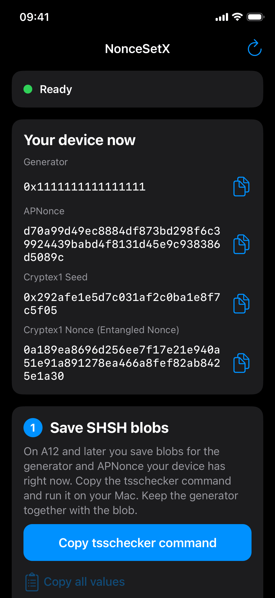
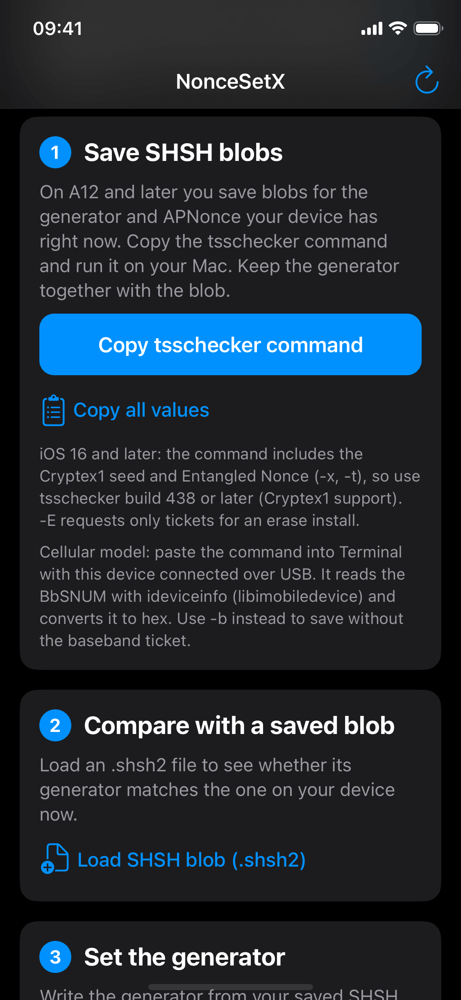
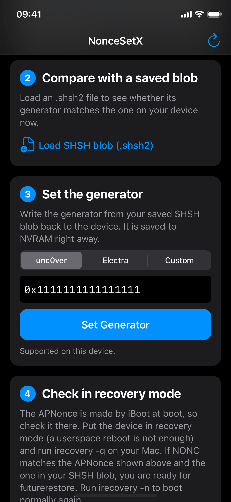
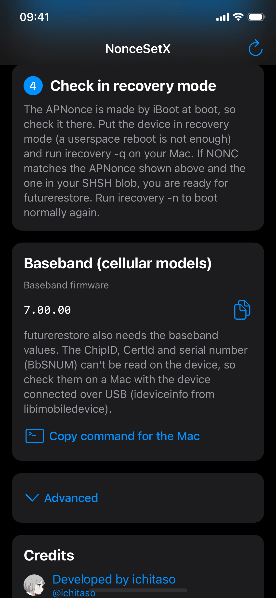

# NonceSetX

Check the APNonce generator and APNonce on Dopamine, save SHSH blobs for them, and write a saved generator back. The successor of [NonceSet143](https://github.com/ichitaso/NonceSet143), rebuilt on top of [x8A4](https://github.com/Cryptiiiic/x8A4).

  
  
  
  

## Requirements
- Dopamine (rootless or roothide) on iOS 15 - 18 or 26. Other jailbreaks (palera1n, Relaxin, ...) are not supported
- iOS 15.0 - 18.4: the bundled x8A4, which needs `libkrw0` and a libkrw plug-in (`libkrw0-dopamine`)
- iOS 18.5 and later / 26: the bundled `nsx26`, which uses Dopamine's `libjailbreak` (`<jbroot>/basebin`). On 18.0 - 18.4 it is also used for setting the generator

## Features
- Show the current generator, APNonce, Cryptex1 seed and Cryptex1 nonce (iOS 16+). The APNonce matches what iBoot reports in recovery mode (`irecovery -q`). When no generator is stored, the one iBoot booted with (`IODeviceTree:/chosen` `boot-nonce`) is shown
- Copy a ready-to-run `tsschecker` command to save blobs for the current generator / APNonce
  - The command is for [1Conan's tsschecker](https://github.com/1Conan/tsschecker). tihmstar's original (build 347) has no Cryptex1 options (`-x`, `-t`) and uses `-c` for the cache
  - iOS 16+: use tsschecker build 438 or 440. Builds 444 and 449 skip the Cryptex1 components in the TSS request and fail with "IS NOT being signed"
  - Cellular models: the command reads the BbSNUM with `ideviceinfo`, so run it on a Mac with libimobiledevice (`brew install libimobiledevice`) and the device connected over USB and trusted. The BbSNUM never changes, so it can be passed with `-c` afterwards; `-b` skips the baseband ticket
  - Saved blobs and a matching generator don't prove that a downgrade will work: a restore also needs a SEP and baseband compatible with the target iOS. No working futurerestore is available right now; keep the blobs for later
- Load an `.shsh2` and check whether its generator matches the device
- ECID (hidden by default), model and board config
- Localized in 17 languages (the same set as Horythia). License texts of bundled software are in the app (Credits > Licenses, `Resources/Acknowledgements.txt`)

### Setting the generator
`com.apple.System.boot-nonce` is a kernel-only NVRAM variable, so x8A4's registry write is refused and its os-dict fallback only changes `IODTNVRAM::_varDict`, which is never written to flash (and `-s` first replaces the real generator with a random one through AppleMobileApNonce).

NonceSetX adds `x8A4 -S <generator>` (`x8A4/Kernel/nvram_v3.c`): it edits the boot-nonce entry in `IONVRAMV3Handler::_varEntries` the same way `setVariableInternal` does (data, crc32, append state), then forces a sync, which rewrites the NVRAM bank from `_varEntries`. Before writing it checks the handler anchors (`_provider`, `_varDict`), the entry name and sizes and the stored CRC; any mismatch aborts without writing. `x8A4 -V` only runs these checks.

How the write is done depends on the NVRAM handler, detected at run time:

| iOS | Handler | Write | Checked on (recovery-mode NONC matched) |
|---|---|---|---|
| 15.0 - 15.3 | none (IODTNVRAM dict) | edit the dict entry, sync | iPhone 7 Plus 15.1 (roothide) |
| 15.4 - 17 | CHRP | edit the dict entry it shares with IODTNVRAM, set `_newData`, sync | iPhone 12 mini 15.4.1, iPad 6 17.5.1 |
| 16 - 17 | V3 | edit the `_varEntries` entry (data, crc32, append state), sync | iPhone 14 Pro 16.5 |
| 18.0 - 18.4 | CHRP (`nsx26` for `-V` / `-S`, x8A4 for reading) | same as CHRP above (`_varDict` is a reference to the IODTNVRAM one, one more read) | iPad 7 18.3.2 |
| 18.5+, 26 | CHRP (`nsx26`) | same as CHRP above | iPad 7 18.6, iPhone 11 Pro 26.0.1 |

A device that never had a generator saved has no `boot-nonce` entry, and iBoot then picks a new random generator on every boot. In CHRP mode `-S` first asks AppleMobileApNonce to generate one (`generateNonce`, the same call the OS uses before an update), which creates the entry, then edits it. On iOS 18.0 - 18.4 x8A4 can't find IODTNVRAM, so the write goes through `nsx26`. palera1n (no kernel r/w) reports "not supported".

Setting the Cryptex1 seed and dumping IOAESAccelerator keys are not exposed on purpose (the former can bootloop).

## How it works
NonceSetX runs its bundled `x8A4` (or `nsx26`) as root (persona spawn) and reads its output. There is no exploit in this app. A process spawned with a root persona still fails IOKit's "root" checks (AppleMobileApNonce, NVRAM writes), so both tools exec themselves once more as root first.

The bundled x8A4 (`x8A4/`, from Cryptiiiic/x8A4 99a79f7) changes:
- `Kernel/kernel.c`: libkrw0-dopamine 2.0.4 returns a kernel base of 0 on Dopamine 3.x, so x8A4 falls back to `kernelConstant.base` from Dopamine's system info
- iOS 15.0 - 15.3 NVRAM dict offset (0xC8 -> 0xE8, `_commonDict`)
- The IOAESAccelerator key array was indexed as `pointer + sizeof * i` on struct pointers (out of bounds), and the 128-entry cleanup list had no bound; both fixed
- Falls back to the `/chosen` generator when none is stored

### nsx26 (iOS 18.5+ / 26)
x8A4's patchfinder does not support these versions, and since xnu-11417.101.15 `IODTNVRAM` no longer has `_varDict` (found by wh1te4ever). `nsx26` (`nsx26/nsx26.c`) takes the x8A4 options NonceSetX uses (`-g -n -x -t -V -S`) and prints the same lines, reading the kernel through libjailbreak without a patchfinder:
- NVRAM: IODTNVRAM `+0x98` (CHRP handler) -> `_varDict` `+0x48`, keys are `<GUID>:<name>`. The handler's `_provider` must point back to IODTNVRAM, otherwise it stops
- APNonce: `sha384(AES128-CBC(key 0x8A3, {0, generator}))[:32]` on A12+, `sha384(generator)[:32]` on older SoCs
- Cryptex1 seed: NVRAM `krn.c1bt` (the "cryptex1 boot" nonce slot), bytes 5 - 20; nonce: `sha384(AES128-CBC(key 0x8A4, seed))[:32]`. The seed and nonce match x8A4 on iOS 16 / 17 and wh1te4ever's x8A4 on iOS 18.6

## Building
`sh build.sh` builds the rootless and roothide packages into `packages/`.

## Credits
- [Cryptiiiic/x8A4](https://github.com/Cryptiiiic/x8A4) (MIT)
- [0x7FF/dimentio](https://github.com/0x7FF/dimentio)
- [stek29](https://stek29.rocks/2018/06/26/nvram.html) (nvram unlock, nonce entanglement research)
- [wh1te4ever](https://github.com/wh1te4ever/x8A4) (x8A4 fork; iOS 18.5+ NVRAM layout research)
- [opa334](https://github.com/opa334/Dopamine) (Dopamine)

## License
NonceSetX is licensed under the [GPLv3](LICENSE).
